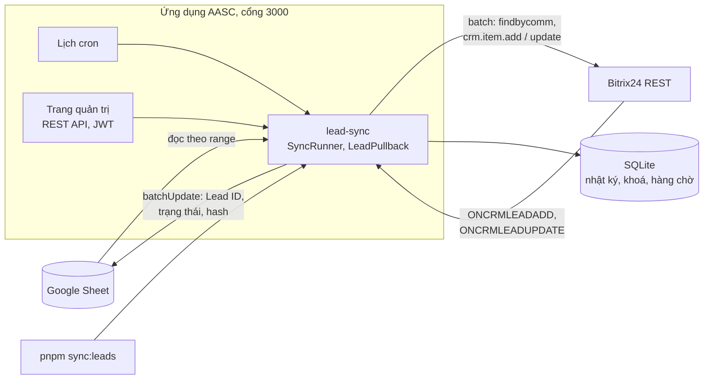
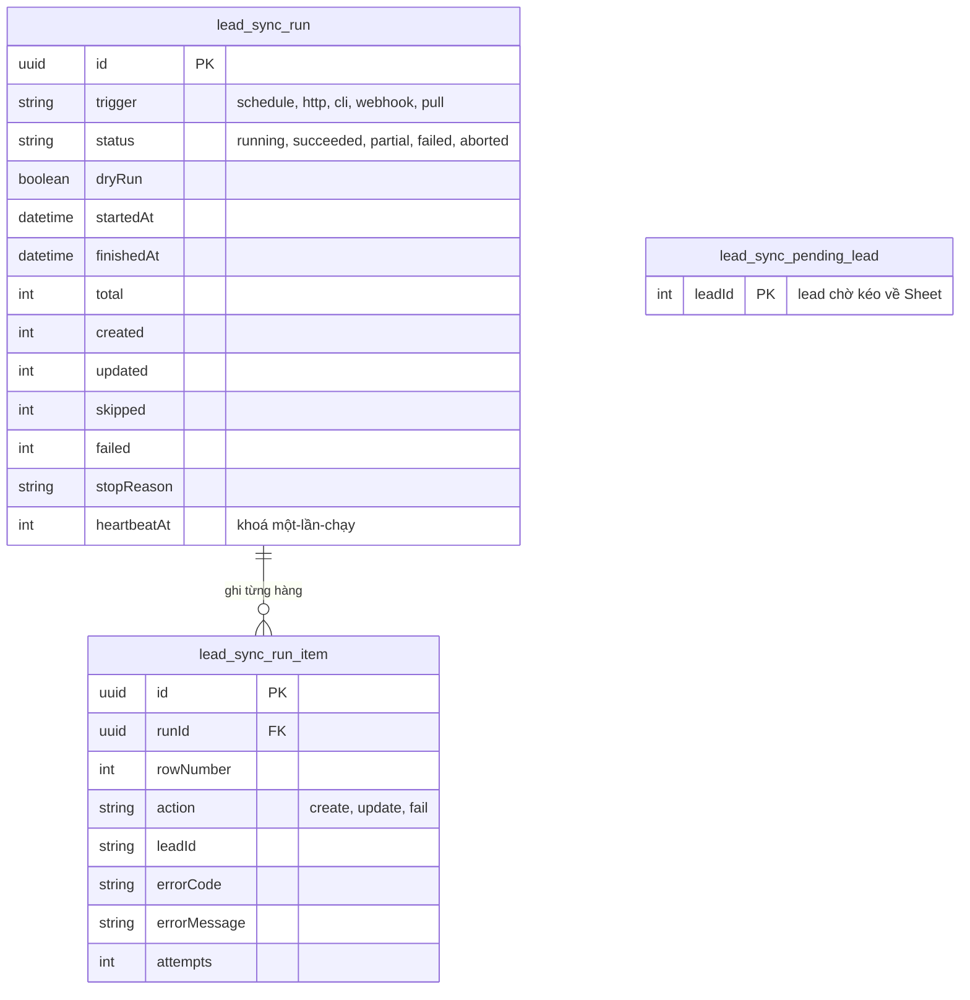

# Tích hợp Google Sheets – Bitrix24 (đồng bộ Lead)

Sales nhập khách hàng tiềm năng vào một Google Sheet. Ứng dụng đọc Sheet, tạo hoặc cập nhật Lead
trong Bitrix24, rồi ghi Lead ID và trạng thái vào chính hàng đó. Khi bật hai chiều, thay đổi trong
Bitrix24 được ghi ngược về Sheet. Đây là một module của ứng dụng AASC: cổng **3000**, SQLite, build
ra `dist/`. Ứng dụng TikTok (cổng 3001) tách biệt.

Hướng dẫn từng bước: [`huong-dan/huong-dan-tich-hop-google-sheets.md`](huong-dan/huong-dan-tich-hop-google-sheets.md).
Video demo (3 phút 14 giây): [`huong-dan/huong-dan-lead-sync.mp4`](huong-dan/huong-dan-lead-sync.mp4).

Google Sheets và Bitrix24 đều là hệ thống thật; không có mock ngoài các test tự động.

## Đối chiếu đề bài

| Yêu cầu của đề | Vị trí |
| --- | --- |
| Đọc Sheet được chỉ định, chín cột chuẩn | `SheetTableService`; cột tìm theo tên tiêu đề |
| Mapping linh hoạt, gồm custom field | [`config/mapping.json`](config/mapping.json); `GET/PUT /lead-sync/mapping`; trường `UF_CRM_*` |
| Tạo và cập nhật Lead, ghi Lead ID vào cột ẩn | `SyncRunner`; cột `Lead ID Bitrix24` và `Sync Hash` được ẩn |
| Chống trùng theo email hoặc số điện thoại | `crm.duplicate.findbycomm` trước mỗi lần tạo |
| Cột trạng thái trên từng hàng | `Trạng thái đồng bộ`, `Lead ID Bitrix24`, `Thời gian đồng bộ cuối`, `Thông báo lỗi` |
| Log số bản ghi tạo, cập nhật, bỏ qua, lỗi | Log từng lần chạy; bảng `lead_sync_run`, `lead_sync_run_item` |
| Chạy theo lịch | `LEAD_SYNC_CRON` |
| Kích hoạt thủ công | `pnpm sync:leads`; `POST /lead-sync/runs` |
| Google Sheets API v4, service account và OAuth 2.0 | `src/modules/google-sheets/`; `GOOGLE_AUTH_MODE` |
| Bitrix24 REST, webhook hoặc OAuth 2.0, batch | `src/modules/bitrix/`; `BITRIX24_WEBHOOK_URL` hoặc ứng dụng cài qua `/install` |
| Rate limit, backoff, retry có giới hạn | Bộ giãn nhịp cho cả hai API; `LEAD_SYNC_MAX_RETRIES` |
| Idempotency, Lead ID và sync hash | Hàng không đổi được bỏ qua; batch timeout được tìm trùng lại trước khi gửi |
| Cấu hình qua file và biến môi trường | [`.env.example`](.env.example) Part 1; `config/mapping.json` |
| Không commit secret | `.env`, `secrets/`, `data/` nằm trong `.gitignore` |
| Điểm cộng: hai chiều, xử lý xung đột | `LEAD_SYNC_DIRECTION=two-way`; Sheet thắng khi hàng có sửa đổi chờ |
| Điểm cộng: real-time qua webhook Bitrix24 | `POST /lead-sync/bitrix-events` |
| Điểm cộng: enum, đa giá trị, chuẩn hoá, validation | Tám kiểu trường trong mapping; lỗi ghi theo từng cột |
| Điểm cộng: giao diện quản trị | `http://localhost:3000/lead-sync.html` |
| File mẫu | `config/mapping.json`, `.env.example`, [`samples/leads-template.csv`](samples/leads-template.csv), [`samples/leads-150.csv`](samples/leads-150.csv) |
| Docker | `Dockerfile`, `docker-compose.yml` |
| Test, coverage từ 70 % | 409 test trong 33 suite; statements 97,2 %, branches 86,8 %, functions 95,1 %, lines 97,8 % (2026-10-12) |

## Kiến trúc



Trạng thái của từng hàng (Lead ID, Sync Hash) nằm trong Sheet. SQLite chỉ giữ nhật ký lần chạy,
khoá một-lần-chạy và hàng chờ sự kiện.

Một lần chạy chiều đi:

1. Kiểm tra cấu hình, chế độ CRM của portal và mapping (cột có trong Sheet, trường có trong
   `crm.item.fields`). Sai thì lần chạy `failed` và không hàng nào bị đụng tới.
2. Đọc Sheet, chuẩn hoá và kiểm tra từng hàng, tính hash nội dung.
3. Bỏ qua hàng có hash khớp `Sync Hash`. Các hàng còn lại đi theo lô 25 hàng.
4. Với mỗi lô: tìm trùng cho hàng chưa có Lead ID, gửi một batch tạo và cập nhật, ghi kết quả
   về Sheet.
5. Ghi bộ đếm và từng hàng đã xử lý vào nhật ký.

| Thành phần | Vị trí | Vai trò |
| --- | --- | --- |
| Điều phối, hàm thuần, API, lịch, hai chiều | `src/modules/lead-sync/` | Kế hoạch đồng bộ, chuẩn hoá, hash, nhật ký |
| Google Sheets | `src/modules/google-sheets/` | Xác thực, đọc theo range, batch update, giãn nhịp |
| Bitrix24 | `src/modules/bitrix/` | REST, batch, OAuth, giãn nhịp |
| CLI | `src/cli/lead-sync.ts`, `src/cli/lead-sheet-seed.ts` | Chạy một lần; sinh và dọn dữ liệu thử |
| Trang quản trị | `public/lead-sync.html`, `public/js/lead-sync.js` | Trạng thái, lịch sử, mapping, chạy tay |

### Cơ sở dữ liệu



Bảng `bitrix_installation` (token OAuth của portal) dùng chung với các bài khác của ứng dụng AASC.

## Chạy nhanh

Cần Node 24.9+, pnpm 11, một Google Sheet và một portal Bitrix24.

```bash
pnpm install
cp .env.example .env         # điền Part 1: Google, Bitrix24, Lead sync
pnpm sync:leads --dry-run    # chạy thử, không ghi gì
pnpm sync:leads              # chạy thật một lần
pnpm start:dev               # server, lịch và trang quản trị
```

- Trang quản trị: <http://localhost:3000/lead-sync.html>, sau khi đăng nhập ở trang chủ
- OpenAPI UI: <http://localhost:3000/docs>
- Health: `/health`

Cấu hình tối thiểu, với service account và incoming webhook:

```dotenv
GOOGLE_SERVICE_ACCOUNT_KEY_FILE=secrets/google-sa.json
GOOGLE_SHEET_ID=<chuỗi giữa /d/ và /edit>
GOOGLE_SHEET_NAME=Leads
BITRIX24_WEBHOOK_URL=https://<portal>.bitrix24.vn/rest/<user id>/<mã>/
```

Tạo Sheet bằng cách import `samples/leads-template.csv`, đổi tên tab thành `Leads`, rồi share quyền
Editor cho email của service account.

## Chạy bằng Docker

```bash
cp .env.example .env
docker compose up -d --build
docker compose run --rm app node dist/cli/lead-sync.js --dry-run
```

`./secrets` được mount ghi được, để lưu refresh token Google. `./config` được mount chỉ đọc, nên
trong Docker phải sửa mapping bằng file trên máy chủ. Container chạy với filesystem gốc chỉ đọc,
không có capability, có giới hạn bộ nhớ, số tiến trình và log.

## Kết nối Google và Bitrix24

**Google**, chọn một trong hai:

- **Service account** (mặc định): lưu file khoá vào `secrets/google-sa.json` hoặc đặt
  `GOOGLE_SERVICE_ACCOUNT_KEY_BASE64`, rồi share Sheet cho `client_email` của khoá.
- **OAuth 2.0**: `GOOGLE_AUTH_MODE=oauth` cùng `GOOGLE_OAUTH_CLIENT_ID`,
  `GOOGLE_OAUTH_CLIENT_SECRET`, `GOOGLE_OAUTH_REDIRECT_URI`. Gọi `GET /google/oauth/authorize` kèm
  JWT, mở `url` trả về và đồng ý. Refresh token được lưu vào `GOOGLE_OAUTH_TOKEN_FILE` với quyền 600.

**Bitrix24**, chọn một trong hai:

- **Incoming webhook**: `BITRIX24_WEBHOOK_URL`, quyền `crm` và `user`. Khi biến này có giá trị,
  mọi lời gọi Bitrix24 đi qua webhook, kể cả khi ứng dụng đã được cài qua OAuth.
- **Ứng dụng OAuth**: `BITRIX24_DOMAIN`, `BITRIX24_CLIENT_ID`, `BITRIX24_CLIENT_SECRET`, và để
  trống `BITRIX24_WEBHOOK_URL`. Hai đường dẫn của ứng dụng cục bộ đều là
  `<địa chỉ công khai>/install`. Chỉ portal trùng `BITRIX24_DOMAIN` được cài.

Portal cần có:

- **Quyền REST API.** Portal không có quyền trả `FEATURE_NOT_AVAILABLE_ON_CURRENT_PLAN` cho mọi
  method; lần chạy dừng ngay với thông báo nêu rõ nguyên nhân.
- **Chế độ CRM cổ điển.** Ở chế độ đơn giản, Bitrix24 tự chuyển lead mới thành Deal và mất giai
  đoạn lấy từ Sheet. Ứng dụng kiểm tra trước mỗi lần chạy và dừng nếu portal không dùng Lead.
- **Scope `crm` và `user`.** Thiếu `user` thì email người phụ trách không tra được và ứng dụng
  dùng `defaults.assignedById`.

## Cấu hình

Mọi biến được mô tả trong Part 1 của [`.env.example`](.env.example).

| Biến | Mặc định | Ý nghĩa |
| --- | --- | --- |
| `GOOGLE_AUTH_MODE` | `service_account` | `service_account` hoặc `oauth` |
| `GOOGLE_SHEET_ID`, `GOOGLE_SHEET_NAME` | trống, `Leads` | Sheet và tab cần đồng bộ |
| `BITRIX24_WEBHOOK_URL` | trống | Incoming webhook; có giá trị thì thay OAuth |
| `LEAD_SYNC_MAPPING_PATH` | `config/mapping.json` | File mapping |
| `LEAD_SYNC_CRON` | trống | Biểu thức cron, ví dụ `*/15 * * * *`; trống là tắt lịch |
| `LEAD_SYNC_TIMEZONE` | `Asia/Ho_Chi_Minh` | Múi giờ của lịch và cột thời gian |
| `LEAD_SYNC_DIRECTION` | `sheet-to-bitrix` | `two-way` bật thêm chiều Bitrix24 về Sheet |
| `APP_PUBLIC_URL` | trống | Địa chỉ công khai, nơi Bitrix24 gửi sự kiện |
| `BITRIX24_OUTGOING_TOKEN` | trống | Token của outgoing webhook tạo tay |
| `LEAD_SYNC_DEFAULT_COUNTRY` | `VN` | Quốc gia khi chuẩn hoá số điện thoại: `VN`, `US`, `SG` |
| `LEAD_SYNC_MAX_RETRIES` | `4` | Số lần thử lại một lời gọi API (0 đến 10) |
| `LEAD_SYNC_LOG_RETENTION_DAYS` | `30` | Số ngày giữ nhật ký lần chạy |

Thiếu cấu hình thì ứng dụng vẫn khởi động, `POST /lead-sync/runs` trả 503 và
`GET /lead-sync/status` nêu thứ còn thiếu. Giá trị sai định dạng (cron, URL webhook, base64) làm
ứng dụng dừng khi khởi động và nêu tên biến.

### Các cột của Sheet

Người dùng nhập chín cột: `Tên khách hàng`, `Email`, `Số điện thoại`, `Công ty`,
`Nguồn lead (UTM Source)`, `Ngân sách dự kiến`, `Trạng thái`, `Người phụ trách`, `Ghi chú`. Mỗi
hàng cần `Tên khách hàng` và ít nhất `Email` hoặc `Số điện thoại`.

Ứng dụng tự thêm năm cột ở lần chạy đầu:

| Cột | Nội dung |
| --- | --- |
| `Trạng thái đồng bộ` | `Chờ xử lý`, `Đã đồng bộ` hoặc `Lỗi` |
| `Lead ID Bitrix24` | Cột ẩn |
| `Thời gian đồng bộ cuối` | `yyyy-MM-dd HH:mm:ss` theo `LEAD_SYNC_TIMEZONE` |
| `Thông báo lỗi` | Cột sai và cách sửa; được xoá khi hàng đồng bộ thành công |
| `Sync Hash` | Cột ẩn |

Cột được tìm theo tên tiêu đề: đổi thứ tự được, đổi tên thì không. Đặt `Trạng thái đồng bộ` thành
`Chờ xử lý` để ép đồng bộ lại một hàng.

### Mapping

```json
{
  "titleTemplate": "{Tên khách hàng} - {Công ty}",
  "defaults": { "currencyId": "VND", "stageId": "NEW", "assignedById": 1 },
  "dedupe": { "keys": ["email", "phone"], "requireAtLeastOne": true },
  "fields": [
    { "column": "Tên khách hàng", "field": "name", "type": "string", "required": true },
    { "column": "Ngân sách dự kiến", "field": "opportunity", "type": "number" },
    { "column": "Mã chiến dịch", "field": "UF_CRM_CAMPAIGN_CODE", "type": "string" }
  ]
}
```

| Kiểu | Ví dụ đầu vào | Gửi sang Bitrix24 |
| --- | --- | --- |
| `string` | `"  Nguyễn  Văn An "` | `"Nguyễn Văn An"` |
| `email` | `"An@Example.com "` | `"an@example.com"` |
| `phone` | `0901 234 567`, `901234567`, `+84 901234567` | `"+84901234567"` |
| `number` | `1.500.000 ₫`, `15tr`, `500k` | `1500000`, `15000000`, `500000` |
| `date` | `08/10/2026`, `2026-10-08`, ô ngày | `"2026-10-08"` |
| `datetime` | `08/10/2026 14:30`, ô ngày giờ | `"2026-10-08T14:30:00+07:00"` |
| `enum` | `Đang liên hệ` | Mã trong bảng `values`, ví dụ `IN_PROCESS` |
| `user` | Email hoặc tên người phụ trách | ID trong bảng `values`, hoặc tra bằng `user.get` |

Ô email hoặc số điện thoại nhận nhiều giá trị, ngăn bằng dấu phẩy, chấm phẩy hoặc xuống dòng. Giá
trị đầu là khoá chống trùng; các giá trị sau được thêm vào lead.

Sửa mapping bằng file, bằng `PUT /lead-sync/mapping`, hoặc trong trang quản trị. Cấu trúc được kiểm
tra khi lưu; tên trường được đối chiếu với portal ở đầu lần chạy kế tiếp. Sửa mapping làm mọi hàng
đồng bộ lại, nên chạy thử trước.

## Cách chạy

| Cách | Lệnh |
| --- | --- |
| Dòng lệnh | `pnpm sync:leads [--dry-run] [--force]` |
| HTTP | `POST /lead-sync/runs` với `{"dryRun": false, "force": false}`, kèm JWT |
| Theo lịch | Đặt `LEAD_SYNC_CRON` rồi chạy server |
| Trang quản trị | Nút "Chạy đồng bộ", "Chạy thử", ô "Đồng bộ lại mọi hàng" |
| Real-time, chiều về | Bitrix24 gọi `POST /lead-sync/bitrix-events` |

Mỗi lúc chỉ có một lần chạy. Lời gọi HTTP trùng lúc nhận 409; nhịp cron trùng lúc bị bỏ qua. Mã
thoát của CLI khác 0 khi lần chạy `failed`, `aborted` hoặc không khởi động được.

| Lệnh | Mục đích |
| --- | --- |
| `pnpm sync:leads` | Chạy một lần và chờ kết quả |
| `pnpm seed:leads [số hàng]` | Thêm hàng thử vào cuối Sheet (mặc định 100) |
| `pnpm seed:leads --clear` | Xoá mọi hàng thử và lead tương ứng trong Bitrix24 |
| `pnpm test`, `pnpm test:e2e`, `pnpm test:cov` | Unit test, E2E, coverage |
| `pnpm check` | Lint, kiểm tra kiểu, unit test, E2E |

Hàng thử mang email thuộc miền `seed.example.com`; lệnh xoá chỉ đụng tới các hàng đó. Lệnh seed
không chạy khi `NODE_ENV=production`.

## Tổng quan API

Mọi endpoint cần JWT lấy từ `POST /auth/login`, trừ endpoint nhận sự kiện.

| Nhóm | Endpoint |
| --- | --- |
| Chạy đồng bộ | `POST /lead-sync/runs` |
| Nhật ký | `GET /lead-sync/runs`, `GET /lead-sync/runs/:id` |
| Trạng thái | `GET /lead-sync/status` |
| Mapping | `GET /lead-sync/mapping`, `PUT /lead-sync/mapping` |
| Hai chiều | `POST /lead-sync/pull`, `POST /lead-sync/bitrix-events/register` |
| Sự kiện Bitrix24 | `POST /lead-sync/bitrix-events` (kiểm bằng `application_token`) |
| Google OAuth | `GET /google/oauth/authorize`, `GET /google/oauth/callback` |
| Cài ứng dụng Bitrix24 | `POST /install`, `GET /install/authorize` |

`POST /lead-sync/runs` trả `202 {"runId": "..."}` và chạy tiếp ở nền. Mọi lỗi có cùng dạng:
`{ statusCode, error, message, path, timestamp }`, với `message` bằng tiếng Việt.

## Chống trùng và idempotency

- Hàng chưa có Lead ID luôn được tìm trùng trước, theo email rồi theo số điện thoại. Tìm thấy thì
  cập nhật lead đó, không thì tạo mới.
- Số điện thoại được tìm theo ba cách viết trong cùng một lệnh: `+84901234567`, `84901234567` và
  `0901234567`. Bitrix24 so khớp theo chuỗi đã lưu, nên lead nhập tay dạng `0901 234 567` chỉ được
  nhận ra khi tìm đúng cách viết đó.
- Khi cập nhật một lead trùng, số điện thoại và email lead đã có được giữ nguyên; hai số được coi
  là một khi chín chữ số cuối giống nhau.
- Hàng đã có Lead ID chỉ được gửi lại khi nội dung đổi. Đổi định dạng ô không tính là đổi.
- Hai hàng trỏ tới cùng một lead: hàng trên được xử lý, hàng dưới nhận "Trùng với hàng N".
- Batch ghi bị timeout không được gửi lại nguyên lệnh: ứng dụng tìm trùng lại trước, nên lead đã
  được tạo ở lần gọi trước không bị tạo lần hai.

## Đồng bộ hai chiều

Bật bằng `LEAD_SYNC_DIRECTION=two-way`. Sự kiện tới `<APP_PUBLIC_URL>/lead-sync/bitrix-events`:

- **Ứng dụng cài qua OAuth**: gọi một lần `POST /lead-sync/bitrix-events/register` kèm JWT.
- **Incoming webhook**: tạo outgoing webhook cho `ONCRMLEADADD` và `ONCRMLEADUPDATE`, chép token
  vào `BITRIX24_OUTGOING_TOKEN`.

Hành vi cần biết:

- **Cột chảy về.** Cột `enum` và `user` (`Trạng thái`, `Người phụ trách`) mặc định có; cột
  `string` và `number` chỉ khi mapping ghi `"pull": true`. Email, số điện thoại, ngày tháng và
  tiêu đề lead chỉ đi từ Sheet sang Bitrix24.
- **Xung đột.** Hàng đã bị sửa trong Sheet sau lần đồng bộ cuối thì Sheet thắng: hàng không bị ghi
  đè, lần chạy chiều đi kế tiếp đẩy giá trị của Sheet lên.
- **Không dội ngược.** Hàng nhận giá trị của Bitrix24 cùng `Sync Hash` mới, nên lần chạy chiều đi
  sau đó bỏ qua nó. Sự kiện do chính lần đồng bộ gây ra tìm thấy Sheet đã khớp và không ghi gì.
- **Lead tạo trong Bitrix24** được thêm thành hàng mới dưới hàng cuối, trừ lead do ứng dụng tạo
  và lead có email hoặc số điện thoại đã nằm trong một hàng.
- **Gom sự kiện.** ID của lead vào hàng chờ trong SQLite; các sự kiện trong 2 giây được xử lý
  chung một lần chạy (`trigger=webhook`). Sự kiện nhận ngay trước khi ứng dụng khởi động lại được
  xử lý lúc khởi động.
- **Kéo tay.** `POST /lead-sync/pull` cập nhật mọi hàng đã liên kết; nó không tìm lead mới.

## Đã kiểm trên hệ thống thật (2026-10-12)

Một Google Sheet thật (xác thực OAuth) và một portal Bitrix24 dùng thử, ứng dụng cài qua OAuth với
scope `crm,user`, sự kiện đi qua một tunnel ngrok. Kịch bản được chạy trên server chạy từ mã nguồn
và chạy lại trên image Docker ở chế độ production.

| Luồng | Kết quả |
| --- | --- |
| Cài ứng dụng OAuth, lưu token | Đạt |
| TC1: hàng mới thành Lead, Lead ID và "Đã đồng bộ" ghi về Sheet | Đạt: 8 lead từ 8 hàng hợp lệ |
| TC2: sửa một ô của hàng đã có Lead ID | Đạt: 1 hàng `updated`, lead đổi theo, thời gian đồng bộ cập nhật |
| TC3: hàng trùng email với lead tạo tay | Đạt: lead có sẵn được cập nhật, không có lead mới |
| TC3: hàng trùng số điện thoại, lead lưu dạng `+84…` | Đạt |
| TC3: hàng trùng số điện thoại, lead lưu dạng `09…` | Đạt sau khi sửa; trước đó một lead trùng đã bị tạo |
| TC4: hàng sai dữ liệu | Đạt: 4 hàng ghi "Lỗi" kèm lý do, các hàng khác vẫn chạy |
| Chạy lại không đổi | Đạt: mọi hàng `skipped`, số lead không đổi |
| 150 hàng mới | Đạt: 150 lead trong 27,3 giây, không lần thử lại nào; chạy lại 4,8 giây |
| Hai chiều: đổi giai đoạn trên Bitrix24 | Đạt: ô `Trạng thái` đổi theo sau vài giây |
| Lead tạo trong Bitrix24 | Đạt: thành hàng mới kèm Lead ID |
| Không dội ngược | Đạt: 125 sự kiện do lần chạy 150 hàng gây ra đều bị bỏ qua |
| Sự kiện giả mạo | Bị từ chối với 403 |
| Lịch cron mỗi phút | Đạt: lần chạy `trigger=schedule` bắt đầu đúng đầu phút |
| Trang quản trị: chạy tay, chạy thử, lịch sử, mapping | Đạt |
| Thao tác tay trên giao diện: nhập hàng trong Google Sheets, bấm "Chạy đồng bộ", đổi giai đoạn trong Bitrix24 | Đạt: lead mang đúng ngân sách, số điện thoại, UTM; hàng đổi giai đoạn sau khoảng 2 giây |
| Portal không có quyền REST | Lần chạy dừng ngay với lý do bằng tiếng Việt, không ghi gì vào Sheet |

Chạy lại trên image Docker với `NODE_ENV=production`:

| Luồng | Kết quả |
| --- | --- |
| Container: user 1000, filesystem gốc chỉ đọc, không capability, healthcheck | Đạt |
| TC1, TC2, TC3 (số điện thoại dạng `09…`), TC4, chạy lại không đổi | Đạt |
| Hai chiều: đổi giai đoạn, lead tạo trong Bitrix24, không dội ngược | Đạt |
| Sự kiện giả mạo; gọi API không có token | 403; 401 |
| `node dist/cli/lead-sync.js --dry-run` trong container | Đạt |
| `seed:leads` ở production | Bị từ chối đúng thiết kế |

Container trong đợt này dùng chung file SQLite với bản chạy từ mã nguồn, để có sẵn bản cài OAuth
của portal. Với volume riêng của `docker-compose.yml`, cần cài lại ứng dụng hoặc dùng incoming
webhook.

Cuối đợt chạy, trước khi dọn: 182 lead trên portal, 178 hàng mang Lead ID, không ID nào trùng nhau. Bốn lead
chênh lệch là các lead tạo tay để thử trùng lặp.

Trong đợt chạy, portal trả `FEATURE_NOT_AVAILABLE_ON_CURRENT_PLAN` cho mọi method trong khoảng 20
phút, sau vài trăm lời gọi trong một giờ, và hoạt động lại sau khi bản dùng thử được kích hoạt
lại. Các lần chạy trong lúc đó dừng với lý do nêu trên; các hàng chưa xử lý được đồng bộ ở lần
chạy kế tiếp.

Sau đợt chạy, `pnpm seed:leads --clear` xoá đúng 150 hàng thử và 150 lead tương ứng; các hàng và
lead thử còn lại được xoá tay. Sheet và portal trở về 9 hàng mẫu với 8 lead, và một lần chạy thử
cho mọi hàng `skipped`.

Chưa kiểm trên hệ thống thật: thử lại khi gặp rate limit hoặc timeout (không lần chạy nào gặp).
Nhánh này có test tự động. Kết quả các đợt chạy trước (500 hàng, service account, incoming
webhook, custom field) nằm ở mục 9 của hướng dẫn.

## Kiểm thử

```bash
pnpm test         # unit test
pnpm test:e2e     # REST và WebSocket, gồm test/lead-sync.e2e-spec.ts
pnpm test:cov     # coverage kèm ngưỡng
pnpm check        # lint + typecheck + unit + E2E + bài Fibonacci
```

Test không gọi Google hay Bitrix24: hai phía được thay bằng bản giả trong
`src/modules/lead-sync/__tests__/support/`.

Kết quả ngày 2026-10-12 cho `src/modules/lead-sync/`, `src/modules/google-sheets/` và hai lệnh CLI:

| Chỉ số | Kết quả |
| --- | --- |
| Test suite | 33 / 33 đạt |
| Test | 409 / 409 đạt |
| Statements | 97,24 % |
| Branches | 86,77 % |
| Functions | 95,07 % |
| Lines | 97,79 % |

## Vận hành

- **Log.** Mỗi lần chạy có một dòng mở đầu, một dòng mỗi lô và một dòng tổng kết. Mỗi hàng lỗi có
  một dòng gồm số hàng, bước thất bại, mã lỗi và thông báo. Log không chứa email, số điện thoại
  hay tên khách hàng.

  ```text
  Lead sync <runId> finished: total=167 created=150 updated=0 skipped=17 failed=0 duration=27.3s
  ```

- **Nhật ký.** Xem trong trang quản trị hoặc `GET /lead-sync/runs`. Lần chạy cũ hơn
  `LEAD_SYNC_LOG_RETENTION_DAYS` ngày tự bị xoá.
- **Kiểm tra nhanh.** `GET /lead-sync/status` trả kết nối Google, kết nối Bitrix24, lịch và lần
  chạy gần nhất.
- **Bù sự kiện bị lỡ.** Bitrix24 không gửi đủ sự kiện khi dữ liệu đổi dồn dập (150 lead tạo liên
  tiếp, 125 sự kiện về tới ứng dụng). Gọi `POST /lead-sync/pull`.
- **Đổi portal.** Sửa `BITRIX24_DOMAIN`, `BITRIX24_CLIENT_ID`, `BITRIX24_CLIENT_SECRET`, cài lại
  ứng dụng, rồi xoá nội dung hai cột `Lead ID Bitrix24` và `Sync Hash`: Lead ID của portal cũ
  không tồn tại trên portal mới.
- **Đổi địa chỉ công khai.** Sửa `APP_PUBLIC_URL`, rồi đăng ký lại sự kiện hoặc sửa handler của
  outgoing webhook.
- **Sao lưu.** File SQLite ở `DATABASE_PATH` và thư mục `secrets/`.
- **Đặt lịch** ngoài giờ nhập liệu cao điểm: hàng bị sắp xếp hoặc chèn lúc đang chạy được hoãn sang
  lần chạy sau.

## Xử lý sự cố

| Hiện tượng | Nguyên nhân và cách xử lý |
| --- | --- |
| `POST /lead-sync/runs` trả 503 | Chưa cấu hình đủ; `GET /lead-sync/status` nêu thứ còn thiếu. |
| `POST /lead-sync/runs` trả 409 | Đang có lần chạy khác. |
| `Gói dịch vụ của portal Bitrix24 không cho dùng REST API` | Portal không có quyền REST, hoặc bị khoá tạm sau khi bị gọi dồn dập. Bật dùng thử, nâng gói, hoặc chờ. |
| `Bitrix24 đang ở chế độ CRM đơn giản` | Chuyển sang CRM cổ điển: CRM > Cài đặt > Chế độ CRM. |
| `Chưa kết nối Bitrix24` | Chưa đặt `BITRIX24_WEBHOOK_URL` và chưa cài ứng dụng. |
| Đã cài OAuth nhưng lời gọi vẫn tới portal cũ | `BITRIX24_WEBHOOK_URL` còn giá trị; để trống rồi khởi động lại. |
| `Bitrix24 installation không khớp` (409 khi cài) | Portal đang cài khác `BITRIX24_DOMAIN`. |
| `Google từ chối truy cập` | Chưa share Sheet quyền Editor, hoặc khoá sai. |
| `Chưa cấp quyền Google` | Chế độ `oauth` nhưng chưa đồng ý: gọi `GET /google/oauth/authorize`. |
| `Spreadsheet không có worksheet tên ...` | Tên tab khác `GOOGLE_SHEET_NAME`; CSV import tạo tab tên khác. |
| `Sheet không có cột ...` | Tiêu đề cột khác với mapping. |
| `Bitrix24 không có trường lead ...` | Sai tên trường trong mapping; đối chiếu `crm.item.fields`. |
| Hàng ghi `Lỗi` | Ô `Thông báo lỗi` nêu cột sai và ví dụ đúng. Sửa ô, hàng tự chạy lại ở lần sau. |
| `Lead không còn tồn tại trong Bitrix24` | Lead đã bị xoá, hoặc Lead ID thuộc portal khác. Xoá ô Lead ID để tạo lại. |
| `Trùng với hàng N` | Hai hàng cùng email hoặc số điện thoại; hàng trên được xử lý. |
| Sự kiện Bitrix24 nhận 403 | `BITRIX24_OUTGOING_TOKEN` khác token của outgoing webhook. |
| Không có sự kiện nào về | `APP_PUBLIC_URL` không truy cập được từ internet, hoặc chưa đăng ký sự kiện. |
| `Current authorization type is denied` khi đăng ký sự kiện | Đang dùng incoming webhook; tạo outgoing webhook thay thế. |

## Quyết định kỹ thuật

- **Sheet giữ trạng thái.** Lead ID và hash nằm cạnh dữ liệu, nên mất SQLite không làm mất liên
  kết giữa hàng và lead, và người dùng thấy ngay hàng nào đã đồng bộ.
- **Hash nội dung đã chuẩn hoá.** Đổi định dạng ô không gây cập nhật. Mapping là một phần của
  hash, nên sửa mapping làm mọi hàng đồng bộ lại.
- **Tìm trùng trước mỗi lần tạo, một lệnh cho mỗi giá trị.** Câu trả lời gắn được với đúng hàng.
  Một lệnh tìm trùng thất bại làm cả lô thất bại, vì coi nó là "không trùng" sẽ tạo lead trùng.
- **Batch 25 hàng.** Một lô cần hai lời gọi Bitrix24 và một lần ghi Sheet; 150 hàng mới tốn 14 lời
  gọi Bitrix24.
- **Lỗi theo hàng, không theo lần chạy.** Hàng sai ghi lý do và bị bỏ qua tới khi được sửa. Lỗi
  tạm thời được thử lại có backoff; hết lượt thì cả lô chờ lần chạy sau.
- **Một lần chạy mỗi lúc.** Khoá nằm trong SQLite kèm heartbeat, dùng chung cho server, CLI và
  chiều về. Lần chạy bị treo được tiếp quản.
- **Sheet thắng khi xung đột.** Người nhập liệu làm việc trong Sheet, nên sửa đổi chưa đồng bộ của
  họ không bị Bitrix24 ghi đè.
- **Sự kiện qua hàng chờ bền.** Endpoint chỉ kiểm token, ghi ID và trả lời; việc kéo về chạy sau,
  nên Bitrix24 không phải chờ và sự kiện không mất khi ứng dụng khởi động lại.
- **Thông báo tiếng Việt cho người vận hành.** Lỗi nêu cột sai, ví dụ đúng và việc cần làm.

## Giới hạn

- Chiều về không gồm email, số điện thoại, ngày tháng và tiêu đề lead.
- Lead tạo trong Bitrix24 lúc ứng dụng không nhận được sự kiện không được thêm vào Sheet về sau;
  kéo tay chỉ cập nhật hàng đã liên kết.
- Tìm trùng theo số điện thoại chỉ suy ra dạng nội địa cho ba quốc gia `VN`, `US`, `SG`. Số của
  nước khác chỉ được tìm ở dạng có và không có dấu `+`.
- Tên trường trong mapping chỉ được đối chiếu với portal ở đầu lần chạy, không phải lúc lưu.
- Khoá một-lần-chạy nằm trong SQLite: server và CLI phải dùng chung file dữ liệu. Nhiều container
  với volume riêng không được hỗ trợ.
- Trong Docker, `./config` chỉ đọc nên trang quản trị không lưu được mapping.
